# Awesome Medical Insurance Prior-Authorization Engines 🏥⚡

<p align="center">
  
</p>

<p align="center">
  <a href="https://github.com/ishandutta2007/Awesome-Awesome-Awesome"></a><a href="https://discord.gg/jc4xtF58Ve"></a>
  <a href="https://github.com/ishandutta2007/Awesome-Medical-Insurance-Prior-Authorization-Engines/stargazers"></a>
  <a href="https://github.com/ishandutta2007/Awesome-Medical-Insurance-Prior-Authorization-Engines/network/members"></a>
  <a href="https://github.com/ishandutta2007/Awesome-Medical-Insurance-Prior-Authorization-Engines/issues"></a>
  <a href="https://github.com/ishandutta2007/Awesome-Medical-Insurance-Prior-Authorization-Engines/blob/main/LICENSE"></a>
  <a href="https://github.com/ishandutta2007/Awesome-Medical-Insurance-Prior-Authorization-Engines/pulls"></a>
  <a href="https://github.com/ishandutta2007"></a>
</p>

---

## 📖 Executive Summary & SEO Guide

The **Awesome Medical Insurance Prior-Authorization Engines** catalog is a comprehensive, production-grade guide to **Electronic Prior Authorization (ePA)**, **Clinical Intelligence Engines**, and **FHIR-native Payer-Provider Automation Platforms**. 

Prior authorization (PA) remains one of the largest administrative burdens in modern healthcare, costing the US healthcare system over **$35 billion annually** in provider overhead, documentation ping-pong, and delayed patient treatment. This curated repository catalogs leading **enterprise SaaS platforms** and **open-source AI multi-agent repositories** designed to automate:
- **Clinical Criteria Matching:** Ingesting unstructured EHR clinical notes and parsing them against medical necessity guidelines (InterQual, MCG, LCD/NCD).
- **CMS-0057-F Interoperability:** Conformance with the CMS Interoperability and Prior Authorization Final Rule, mandating automated Da Vinci PAS (Prior Authorization Support), CRD (Coverage Requirements Discovery), and DTR (Documentation Templates and Rules).
- **LLM Multi-Agent Orchestration:** Deploying autonomous agent swarms (LangGraph, Azure Agent Framework, Bedrock) to extract chart data, draft justification letters, submit ANSI X12 278 EDI/FHIR requests, and handle denial appeals.

---

## 📑 Table of Contents

- [📊 Sector Overview & Market Dynamics](#-sector-overview--market-dynamics)
- [🏢 SaaS & Hosted Platforms](#-saas--hosted-platforms)
- [💻 Open-Source GitHub Projects](#-open-source-github-projects)
- [🧩 Architecture Patterns & Standards](#-architecture-patterns--standards)
- [🤝 How to Contribute](#-how-to-contribute)
- [⭐ Star History](#--star-history)
- [💖 Support & Sponsorship](#-support--sponsorship)
- [⚠️ Disclaimer](#️-disclaimer)

---

## 📊 Sector Overview & Market Dynamics

The global medical prior authorization software market is valued at **$1.74B – $2.76B (2024–2026)** and is projected to surge to **$5.68B – $5.99B by 2033–2036** at an aggressive Compound Annual Growth Rate (CAGR) of **14.1% – 19.4%**, driven by the federal CMS-0057-F interoperability enforcement timeline, severe clinical workforce shortages, and the adoption of generative AI copilots.

The market structure is **moderately fragmented**:
- **Core Clearinghouse Rails:** National transaction pipelines remain consolidated among legacy revenue cycle and payer network giants (**McKesson/CoverMyMeds**, **Elevance Health/Carelon**, **Waystar**, and **Availity**), who maintain direct EDI 278 and clearinghouse connectivity into thousands of provider EHRs and payer adjudication engines.
- **AI-Native Clinical Disrupters:** Clinical document intelligence, natural language criteria extraction, and touchless decisioning are aggressively contested by fast-scaling AI innovators (**Cohere Health**, **Infinitus Systems**, **Rhyme**, **Basys.ai**, and **Banjo Health**).
- **No Winner-Take-All Monopoly:** Because healthcare delivery spans hundreds of regional health plans, state Medicaid programs, varying benefit structures, and distinct clinical specialties, no single vendor commands a total monopoly. Growth is characterized by strategic co-opetition, API-driven partnerships, and large-scale M&A rollups.

---

## 🏢 SaaS & Hosted Platforms

Below is the structured breakdown of the leading commercial medical prior authorization and utilization management engines, **sorted descending by company size (valuation / enterprise value / parent market cap)**:

| Platform / Company | Company Size (Valuation / Revenue) 📈 | Starting Tier Pricing 🏷️ | Free Tier / Trial Limits ⏱️ | Key Focus & Capabilities 🎯 |
| :--- | :--- | :--- | :--- | :--- |
| **[Carelon](https://www.carelon.com/)** *(Elevance Health)* | **~$85 Billion** parent market cap / **$48 Billion** annual division revenue | **$1.85 – $3.20 PMPM** (per member per month) base administrative fee for health plan utilization management & post-acute suites | **No free-forever plan**; **30-day structured payer validation pilot** with historical claims benchmarking upon executed enterprise MSA | Enterprise payer utilization management, post-acute care transitions, oncology & musculoskeletal criteria reviews, and Care Navigator coordination. |
| **[CoverMyMeds](https://www.covermymeds.com/)** *(McKesson)* | **~$100 Billion** parent market cap / **$1.1 Billion** acquisition valuation / **$650M+** ARR | **$0 (100% Free)** for prescribers & dispensing pharmacies; commercial payer & enterprise EHR clearinghouse connections start at **$500/provider/month** or **$4.25/non-sponsored transaction** | **Free-forever plan** with unlimited electronic prior authorization (ePA) submissions for licensed prescribers and retail pharmacies across all participating PBM/health plan networks | Medication ePA category leader connecting prescribers, pharmacies, and payers with real-time benefit checks and automated formulary exception routing. |
| **[Waystar](https://www.waystar.com/)** *(NASDAQ: WAY)* | **$5.1 Billion** market cap / **$6.5 Billion** enterprise value / **$1.2 Billion** ARR | **$149/provider/month** base practice subscription for Authorization Manager, or **$4.50 per submitted prior auth transaction** | **No free-forever plan**; **14-day interactive sandbox trial** with sample clinical claim sets provided during sales-assisted onboarding | Comprehensive financial clearance suite with Auth Accelerate, automated EHR order scraping, real-time approval without clinical notes, and ANSI 278 EDI submission. |
| **[Olive AI](https://oliveai.com/)** *(Legacy Tech / Waystar)* | **$4.0 Billion** historical peak valuation *(prior-auth assets acquired by Waystar & Availity)* | **$10,000/month** base enterprise health system deployment tier, or **$6.00 per automated EHR clinical extraction event** *(now unified in Waystar Auth Accelerate)* | **No free-forever plan**; **30-day proof-of-value workflow evaluation** capped at 100 historical authorization charts for health system networks | Computer vision and robotic process automation (RPA) pioneer connecting hospital EHRs with payer portals for automated point-of-care authorization filing. |
| **[Availity](https://www.availity.com/)** *(Francisco Partners & Novo)* | **$2.5 Billion** enterprise valuation / **$350 Million+** annual revenue | **$35/provider/month** for Premium Essentials clearinghouse, or **$0.35 – $0.75 per ANSI 278 EDI transaction**; API Connectivity Hub begins at **$1,500/month** for health systems | **Free-forever tier** for healthcare providers submitting single prior authorizations and eligibility checks directly through participating payer web portals | CMS-0057-F Interoperability Suite, Prior Authorization Connectivity Hub orchestrating Da Vinci CRD/DTR/PAS APIs, and national payer gateway. |
| **[Cohere Health](https://www.coherehealth.com/)** | **$750 Million** valuation *(Series C led by Temasek)* / **$45 Million+** ARR | **$2.10 – $4.50 PMPY** (per member per year) health plan platform license, or **$18.00 per completed clinical review assist episode** for risk-bearing provider groups | **No free-forever plan**; **60-day retrospective data pilot** with up to 500 historical authorization charts analyzed for clinical ROI gap-analysis | Clinically trained AI platform achieving up to 90% automated authorization decisions, Cohere Review Assist for inpatient workflows, and Cohere Align for gold-carding. |
| **[Infinitus Systems](https://www.infinitus.ai/)** | **$600 Million** valuation *(Series C led by a16z)* / **$30 Million+** ARR | **$2,500/month** base platform commitment including first 1,000 automated calls; **$2.50 per additional voice AI prior auth status check call / follow-up** | **No free-forever plan**; **14-day / 50-call live voice-agent pilot sandbox** with call recordings and transcript access for qualified provider RCM teams | Autonomous Voice AI agents (Eva & FastTrack) automating outbound prior authorization verification calls, IVR navigation, and appeal follow-ups with Salesforce Health Cloud. |
| **[Rhyme](https://www.getrhyme.com/)** *(formerly PriorAuth Online)* | **$100 Million** valuation / **$25 Million+** venture funding / **$12 Million+** ARR | **$750/provider/month** for specialty outpatient clinics, or **$5.20 per touchless prior authorization submission** with automated clinical chart scraping | **No free-forever plan**; **30-day zero-risk live pilot** covering up to 150 live prior authorization submissions for eligible outpatient surgical/specialty clinics | Touchless prior authorization network processing 4M+ requests yearly across 83 health systems and 300+ payers, featuring automated Gold Carding rules. |
| **[Basys.ai](https://basys.ai/)** | **$50 Million** valuation *(backed by Mayo Clinic & Highmark)* / **$5 Million+** ARR | **$2,200/month** platform base fee for regional health plans and specialty clinics, plus **$2.25 per automated prior auth decision co-pilot run** | **No free-forever plan**; **30-day evaluation sandbox** with up to 50 synthetic/de-identified prior auth policy test runs | Generative AI copilot for prior auth and utilization management trained on 10M+ medical records; automates 85% of decisions with 98% clinical accuracy and zero hallucinations. |
| **[Banjo Health](https://www.banjohealth.com/)** | **$25 Million** valuation / **$6.5 Million** venture funding / **$3.5 Million+** ARR | **$3,500/month** base subscription for BanjoPA & Composer engine, or **$15,000/year base tier** for up to 5,000 automated decision-tree evaluations | **No free-forever plan**; **21-day interactive sandbox trial** including 3 custom policy PDF-to-decision-tree conversions upon sales qualification | Cloud-native intelligent clinical decision tree builder (Composer) converting complex payer PDF policies into machine-readable logic in minutes using OCR/NLP. |

---

## 💻 Open-Source GitHub Projects

Curated open-source prior authorization engines, reference implementations, and agent accelerators — **ranked descending by GitHub Stars_Count**. Each Stars_Badge links directly to that repository's stargazers community:

### 1. 🤖 [Microsoft Prior-Authorization Multi-Agent Accelerator](https://github.com/microsoft/Prior-Authorization-Multi-Agent-Solution-Accelerator) [](https://github.com/microsoft/Prior-Authorization-Multi-Agent-Solution-Accelerator/stargazers)
- **Primary Focus:** Payer-side AI-assisted prior authorization review framework.
- **Tech Stack:** Microsoft Agent Framework, Azure Container Apps, Model Context Protocol (MCP), Azure OpenAI.
- **Key Features:** Four specialized Foundry-hosted agents (**Compliance, Clinical, Coverage, and Synthesis**). Features gate-based clinical decision rubrics, MCP healthcare data access, confidence scoring, comprehensive audit trails, and human-in-the-loop review. Deploys cleanly via `azd`.

### 2. ⚡ [Azure AutoAuth Solution Accelerator](https://github.com/Azure-Samples/autoauth-solution-accelerator) [](https://github.com/Azure-Samples/autoauth-solution-accelerator/stargazers)
- **Primary Focus:** End-to-end cloud pipeline automating prior authorization extraction and verification.
- **Tech Stack:** Azure AI Document Intelligence, Azure OpenAI Service, FHIR Service, Cosmos DB.
- **Key Features:** Ingests clinical notes, forms, and insurance policies; extracts structured clinical criteria; and cross-references patient health records against coverage rules with full explainability.

### 3. 🏛️ [WSO2 CMS-0057-F Reference Implementation](https://github.com/wso2/reference-implementation-cms0057f) [](https://github.com/wso2/reference-implementation-cms0057f/stargazers)
- **Primary Focus:** Production-grade reference implementation for the CMS Interoperability and Prior Authorization Rule.
- **Tech Stack:** Ballerina, Java, Docker, React, FHIR R4.
- **Key Features:** Modular microservices architecture featuring `cds-service` (port 9096), `rule-engine` (port 9097), `fhir-service`, `demo-ehr-app`, and `demo-dtr-app`. Implements Da Vinci CRD, DTR, and PAS profiles across both provider and payer mock workflows.

### 4. 📜 [HL7 Da Vinci PAS Implementation Guide](https://github.com/HL7/davinci-pas) [](https://github.com/HL7/davinci-pas/stargazers)
- **Primary Focus:** Official HL7 FHIR Implementation Guide repository for Prior Authorization Support.
- **Tech Stack:** FHIR Shorthand (FSH), IG Publisher, Jekyll.
- **Key Features:** Defines the official FHIR profiles, value sets, extensions, and `$submit` / `$inquire` operations that bridge clinical EHR requests with ANSI X12 278 payer transaction standards.

### 5. 🛡️ [ACB Labs Multi-LLM Governed Prior Auth Engine](https://github.com/acblabs/multi_llm) [](https://github.com/acblabs/multi_llm/stargazers)
- **Primary Focus:** Governed multi-model AI control plane for clinical prior authorization decision support.
- **Tech Stack:** Python, LangChain, Multi-LLM ensembles, Pydantic, HIPAA audit logging.
- **Key Features:** PHI-safe audit trails, human-in-the-loop validation checkpoints, structured evidence packet assembly, and deterministic governance evaluations comparing model decisions against published clinical policies.

### 6. 🩺 [Clinical Prior Auth Agent](https://github.com/SenayYakut/ClinicalPriorAuthAgent) [](https://github.com/SenayYakut/ClinicalPriorAuthAgent/stargazers)
- **Primary Focus:** Clinical decision support and authorization drafting agent.
- **Tech Stack:** Azure OpenAI GPT-4, Python, Streamlit, Vector RAG.
- **Key Features:** Automates payer medical policy lookups, evaluates clinical criteria compatibility, predicts approval likelihood, drafts formal justification letters, and routes low-confidence cases to human clinicians.

### 7. ☁️ [AWS Sample Healthcare Agents](https://github.com/aws-samples/sample-healthcare-agents) [](https://github.com/aws-samples/sample-healthcare-agents/stargazers)
- **Primary Focus:** Prior authorization and clinical agents using Amazon Bedrock, HealthLake, and CDS Hooks.
- **Tech Stack:** Amazon Bedrock (Claude), AWS HealthLake, Comprehend Medical, CDS Hooks, TypeScript.
- **Key Features:** Live-streams model reasoning and Gateway tool execution. Evaluates medical necessity, performs `lookup_prior_auth_requirements`, and writes verified FHIR `ClaimResponse` and `Task` resources directly back to AWS HealthLake.

### 8. 🔍 [AWS Sample Prior Authorization Assistant](https://github.com/aws-samples/sample-prior-authorization-assistant) [](https://github.com/aws-samples/sample-prior-authorization-assistant/stargazers)
- **Primary Focus:** Provider-side document extraction and criteria matching assistant.
- **Tech Stack:** Amazon Textract, Amazon Bedrock Knowledge Bases (RAG), React, AWS Lambda.
- **Key Features:** Extracts clinical metrics from medical PDFs and FHIR JSON documents, matches findings against vector-embedded payer policies, and produces detailed gap analysis with actionable clinical submission recommendations.

### 9. 🧪 [FHIR PAS Test Kit (Inferno Framework)](https://github.com/inferno-framework/davinci-pas-test-kit) [](https://github.com/inferno-framework/davinci-pas-test-kit/stargazers)
- **Primary Focus:** Conformance testing and validation for Da Vinci Prior Authorization Support implementations.
- **Tech Stack:** Ruby, Inferno Core Framework, Docker, FHIR R4.
- **Key Features:** Validates both payer (Server Suite) and provider (Client Suite) implementations against PAS STU 2.0.1 and v2.2.1 specifications. Tests simulated approval/denial/pended workflows, FHIR profile structures, and SMART/UDAP security protocols.

### 10. 🏥 [HL7 Da Vinci Prior Auth Client](https://github.com/HL7-DaVinci/prior-auth-client) [](https://github.com/HL7-DaVinci/prior-auth-client/stargazers)
- **Primary Focus:** Reference client application demonstrating Da Vinci PAS transactions.
- **Tech Stack:** Java, Spring Boot, HAPI FHIR, Docker.
- **Key Features:** Simulates EHR prior authorization bundle generation, communicates with compliant PAS servers, and demonstrates clinical document attachment packaging.

### 11. 🧠 [PACCA Multi-Agent Prior Auth Platform](https://github.com/drdgreed/pacca) [](https://github.com/drdgreed/pacca/stargazers)
- **Primary Focus:** Autonomous prior-authorization evaluation platform.
- **Tech Stack:** Python, RAG architectures, OpenTelemetry, FastAPI.
- **Key Features:** Observability-first multi-agent architecture designed to ingest patient charts, evaluate clinical evidence against payer rulesets, and log full decision traces with explainability metrics.

### 12. 📋 [PA Tracker](https://github.com/cashmy/pa_tracker) [](https://github.com/cashmy/pa_tracker/stargazers)
- **Primary Focus:** Lightweight prior authorization tracker for small outpatient and therapy clinics.
- **Tech Stack:** PHP, MySQL, JavaScript, Bootstrap.
- **Key Features:** Tracks authorization expiration dates, approved visit counts, pending renewal alerts, and payer submission dates for specialty outpatient practices.

### 13. 🔌 [n8n Waystar RCM Integration Node](https://github.com/Velocity-BPA/n8n-nodes-waystar) [](https://github.com/Velocity-BPA/n8n-nodes-waystar/stargazers)
- **Primary Focus:** Workflow automation node for Waystar healthcare RCM and prior authorization APIs.
- **Tech Stack:** TypeScript, n8n community node API.
- **Key Features:** Automates real-time eligibility checks (270/271), claims submission (837), remittance review (835), and electronic prior authorization requests (278) directly in low-code workflows.

### 14. 🌐 [Prior Auth B2B Portal](https://github.com/TaylorOne/prior-auth-portal) [](https://github.com/TaylorOne/prior-auth-portal/stargazers)
- **Primary Focus:** Full-stack portal modeling B2B workflow between prescribers and payers.
- **Tech Stack:** .NET Minimal API, React, Azure Cloud, FHIR R5 schemas.
- **Key Features:** Interactive web interface for clinicians to assemble prior authorization dossiers, validate required fields, and monitor insurer adjudication status in real time.

### 15. 🔬 [LangGraph Prior Auth Multi-Agent Suite](https://github.com/dstampfli/prior-auth-agents) [](https://github.com/dstampfli/prior-auth-agents/stargazers)
- **Primary Focus:** Multi-agent pipeline with LangGraph and LangSmith evaluation.
- **Tech Stack:** LangGraph, LangSmith, Python, ChromaDB.
- **Key Features:** Four specialized agents, deterministic policy retrieval, compliance-driven human-in-the-loop review gates, and an automated 12-case evaluation benchmark with synthetic medical records.

### 16. ✍️ [Attest AI Prior Auth Agent](https://github.com/ojassug/Attest) [](https://github.com/ojassug/Attest/stargazers)
- **Primary Focus:** Specialty practice prior authorization lifecycle agent.
- **Tech Stack:** Strands Agents SDK, Python, FastAPI.
- **Key Features:** Determines authorization requirements, extracts criteria-matched proof from EHR notes, drafts clinical justifications, and auto-generates formal appeal packets when claims are denied.

### 17. 🩺 [Healthcare Operations Agents (ClinicalMind)](https://github.com/akash-dev-18/Healthcare-operations-agents) [](https://github.com/akash-dev-18/Healthcare-operations-agents/stargazers)
- **Primary Focus:** End-to-end clinical chart synthesis and prior auth verification.
- **Tech Stack:** Python, LangGraph, FastAPI, MedCAT / Clinical NER.
- **Key Features:** Converts unstructured clinical consultation notes into structured ICD-10/CPT codes, executes prior auth checklist verification, and flags missing documentation prior to insurer submission.

### 18. 📝 [Prior Authorization Assistant](https://github.com/Sakshi3027/prior-auth-assistant) [](https://github.com/Sakshi3027/prior-auth-assistant/stargazers)
- **Primary Focus:** Provider-side AI agent drafting requests from clinical notes.
- **Tech Stack:** LangGraph, Groq (Llama 3.3 70B), Supabase (Postgres + pgvector), FHIR R4.
- **Key Features:** Five-node LangGraph pipeline (`extract → triage → retrieve → evaluate → draft`), human-in-the-loop overrides, batch processing mode, and CMS-compliant FHIR PAS API export layer.

### 19. 🔄 [MediAuth-AI](https://github.com/JainRamyak/MediAuth-AI) [](https://github.com/JainRamyak/MediAuth-AI/stargazers)
- **Primary Focus:** 7-agent autonomous system managing prior authorization from intake to appeal.
- **Tech Stack:** LangGraph, FastAPI, Flutter, Groq, ChromaDB, Claude Sonnet.
- **Key Features:** 7 agents covering Medical Analysis, Policy Intelligence, Justification Writing, Submission Monitoring, Claims Validation, and an autonomous recursive Appeal Loop (`submit → deny → appeal → resubmit`).

### 20. ⚡ [Prior Auth Ambient Agent](https://github.com/paullopez-ai/prior-auth-ambient-agent) [](https://github.com/paullopez-ai/prior-auth-ambient-agent/stargazers)
- **Primary Focus:** Serverless event-driven prior authorization agent on Google Cloud Platform.
- **Tech Stack:** GCP Pub/Sub, Cloud Run, Vertex AI Gemini, BigQuery.
- **Key Features:** Three-node minimal pipeline (`CriteriaEvalNode → ConfidenceRoutingNode → AuditWriteNode`). Automatically routes low-confidence determinations to human clinicians and writes immutable audit logs to BigQuery.

### 21. 📡 [Prior Auth Radar](https://github.com/paullopez-ai/prior-auth-radar) [](https://github.com/paullopez-ai/prior-auth-radar/stargazers)
- **Primary Focus:** Practice-facing clinical prioritization and CMS compliance dashboard.
- **Tech Stack:** Next.js 16, Claude Sonnet 4.6, Optum Real API sandbox, Tailwind CSS.
- **Key Features:** Live PA status polling, clinical urgency prioritization based on procedure dates, outcome prediction (approval probability & peer-to-peer recommendation), and CMS January 2026 response window compliance tracking.

---

## 🧩 Architecture Patterns & Standards

When architecting an enterprise or open-source prior authorization engine, implementations generally align with the **HL7 Da Vinci Project** and **CMS-0057-F Interoperability Suite**:

```
+-----------------------------------------------------------------------------------+
|                            EHR / PROVIDER SYSTEM                                  |
|                                                                                   |
|  [Clinical Order] ---> [CDS Hooks Discovery (CRD)] ---> [Smart on FHIR App (DTR)]|
|                                                                    |              |
+--------------------------------------------------------------------+--------------+
                                                                     |
                                                Da Vinci PAS Bundle ($submit)
                                                                     v
+-----------------------------------------------------------------------------------+
|                        PRIOR AUTHORIZATION AI ENGINE                              |
|                                                                                   |
|  +--------------------+   +---------------------+   +--------------------------+  |
|  | Clinical NER & NLP |-->| Policy RAG (Vector) |-->| Multi-Agent LLM Copilot  |  |
|  | (ICD-10 / CPT)     |   | (Payer PDF Policies)|   | (Criteria Verification)  |  |
|  +--------------------+   +---------------------+   +--------------------------+  |
|                                                                    |              |
+--------------------------------------------------------------------+--------------+
                                                                     |
                                          ANSI X12 278 EDI / FHIR ClaimResponse
                                                                     v
+-----------------------------------------------------------------------------------+
|                              PAYER ADJUDICATION ENGINE                            |
|                                                                                   |
|       [Touchless Auto-Approval]  <--- OR --->  [Clinical Review Queue (HITL)]     |
+-----------------------------------------------------------------------------------+
```

- **CRD (Coverage Requirements Discovery):** Evaluates during the order creation workflow via CDS Hooks whether an authorization is required for the prescribed therapy or procedure.
- **DTR (Documentation Templates & Rules):** Launches a SMART on FHIR questionnaire populated with EHR chart notes using CQL (Clinical Quality Language) to gather needed clinical evidence.
- **PAS (Prior Authorization Support):** Packages structured FHIR `Claim` bundles and transforms them to/from standard HIPAA X12 278 transactions for direct payer adjudication.

---

## 🤝 How to Contribute

We welcome contributions from healthcare engineers, clinicians, health informatics researchers, and open-source contributors!

1. 🍴 **Fork the Repository** on GitHub.
2. 🌿 **Create a Feature Branch**: `git checkout -b feature/add-new-pa-engine`.
3. 📝 **Add Your Entry**:
   - For SaaS products: include full pricing details, exact free trial limits, valuation/revenue metrics, and objective technical capabilities.
   - For Open-Source repositories: include repository link, Stars_Badge linked to `/stargazers`, tech stack breakdown, and core features.
4. 📬 **Submit a Pull Request**: Detail the rationale and link to official documentation or source code.

---

##  Star History

[](https://saar-history.dera.page/#ishandutta2007/Awesome-Medical-Insurance-Prior-Authorization-Engines&type=date&legend=top-left)

---

## 💖 Support & Sponsorship

Thank you for exploring and utilizing the **Awesome Medical Insurance Prior-Authorization Engines** ecosystem! Building and maintaining an accurate, up-to-date directory of healthcare AI, interoperability standards, and clinical automation requires continuous curation and deep research.

If this repository has saved your team research time, inspired an architecture design, or assisted your clinical integration:
- ⭐ **Star this repository** to help others in the healthtech community discover it.
- 🍴 **Fork the repo** to build your own healthcare tools or contribute back.
- 📢 **Share it** on LinkedIn, X/Twitter, and healthcare informatics forums.
- ☕ **Buy us a coffee & support ongoing research** via the [GitHub Sponsor Dashboard](https://github.com/sponsors/ishandutta2007)!

---

## ⚠️ Disclaimer

- This repository is a **community-curated research directory** provided for educational, informational, and architectural comparison purposes only. It does not constitute formal medical, legal, or financial advice.
- All enterprise names, trademarks, logos, and service marks are the property of their respective owners.
- **Clinical Governance & Safety:** Automated criteria matching and LLM generation can misinterpret nuanced medical notes or reference outdated payer guidelines. **All automated prior authorization submissions and appeals must undergo qualified clinical review by licensed healthcare professionals** before transmittal to insurance carriers. All sample data referenced in open-source projects is synthetic — never transmit real Protected Health Information (PHI) without verified Business Associate Agreements (BAAs) and HIPAA-compliant infrastructure.

## Star History

<a href="https://star-history.com/#ishandutta2007/Awesome-Medical-Insurance-Prior-Authorization-Engines&Timeline" align="center">
  <picture>
    <source media="(prefers-color-scheme: dark)" srcset="assets/ishandutta2007_Awesome-Medical-Insurance-Prior-Authorization-Engines_growth.svg">
    
  </picture>
</a>
