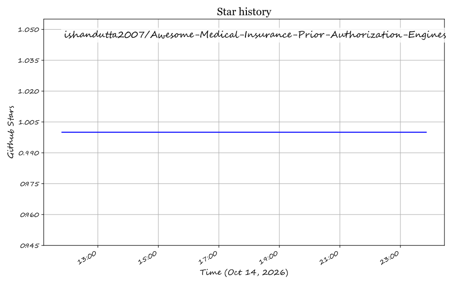

# Awesome-Medical-Insurance-Prior-Authorization-Engines

# Awesome-Medical-Insurance-Prior-Authorization-Engines

## Top Medical Insurance Prior-Authorization Engines Ecosystem

**Curated List of SaaS Products & Open-Source GitHub Projects**  
*Focused on Clinical Criteria Matching, Automated Decisioning & Payer-Provider Workflow Automation*  
**Last updated: March 2026**

This repository tracks notable **SaaS platforms** and **open-source projects** for **Medical Insurance Prior-Authorization Engines**. These tools automate the process of matching treatment codes and clinical documentation to insurer requirements — reducing the administrative burden on providers and accelerating patient access to care.

**Examples** include Cohere Health, Olive AI, Banjo Health, Infinitus Systems, CoverMyMeds, Basys.ai, Rhyme, Carelon, Waystar, and Availity (the category leaders).

**Open-source emphasis**: This section is expanded with every major active project for self-hosting, custom criteria engines, and transparent prior-auth workflows — ideal for healthcare engineers prioritizing data sovereignty, developers building clinical decision support, and organizations avoiding per-transaction enterprise pricing.

Contributions welcome! Open a PR to add/update entries. Keep descriptions factual and link to official sites.

## Table of Contents
- [SaaS/Hosted Platforms](#saas-hosted-platforms)
- [Open-Source GitHub Projects](#open-source-github-projects)
- [How to Contribute](#how-to-contribute)
- [Disclaimer](#disclaimer)

## SaaS/Hosted Platforms

- **[Cohere Health](https://www.coherehealth.com/)**  
  Clinical intelligence platform for health plans that automates up to **90% of prior authorization requests** with clinically trained AI. Health plans report **70% faster access to care**, **61% reduction in provider input time**, and **50% faster medical necessity reviews**. In 2025, achieved **94% provider satisfaction**, **85% real-time authorization approvals**, and **8x ROI** for health plan partners. Features **Cohere Review Assist** for clinical reviewers to complete inpatient authorization requests nearly 50% faster, and **Cohere Align** for provider performance optimization.

- **[Olive AI](https://oliveai.com/)**  
  AI-powered automation for revenue cycle management with **End-to-End Prior Authorization** solution. Seamlessly connected to provider EHR systems, automatically initiates prior authorizations, retrieves payer rules, and identifies clinical documentation from the EHR. Health systems report getting prior auth decisions **up to 5 days faster** with Olive's automation. Supports both provider-side and payer-side point-of-care authorization workflows.

- **[Banjo Health](https://www.banjohealth.com/)**  
  Cloud-native, AI-powered prior authorization platform with **Composer**, an intelligent clinical decision tree builder. Composer ingests payer policy PDFs using OCR and NLP, identifies decision points, and converts them into **machine-readable clinical decision trees in minutes** — work that previously required weeks. **BanjoPA** intelligently routes cases using diagnosis codes and clinical indicators, reducing manual triage and improving first-pass resolution. Reduces labor required to build and maintain PA logic by **up to 75%** and cuts update cycles by roughly half.

- **[Infinitus Systems](https://www.infinitus.ai/)**  
  Voice AI agents for healthcare that automate **prior authorization status checks**, appeals follow-ups, and formulary exception calls. Expanded partnership with Salesforce allows deployment from within **Health Cloud and Life Sciences Cloud** via Agentforce and MuleSoft connectors. Features **FastTrack** for bypassing IVR and hold times, and a **7-layer AI review system** with human-in-the-loop for quality assurance.

- **[CoverMyMeds](https://www.covermymeds.com/)**  
  Electronic prior authorization platform connecting prescribers, pharmacies, and payers. Guides prescribers through required clinical questions with **opportunity for real-time approval** when criteria are met. Pharmacy providers can initiate medication ePA requests on behalf of members, directing cases to prescriber queues.

- **[Basys.ai](https://basys.ai/)**  
  Generative AI co-pilot for prior authorization and utilization management. Automates **85% of prior auth decisions** with **98% clinical accuracy**, reducing average decision time by **8 days**. Trained on data from **10 million+ member medical and claims records** from Mayo Clinic and partners. Recognized in **Gartner's 2025 Hype Cycle** for U.S. Healthcare Payers for AI-driven Prior Auth. Features **no hallucinations**, compliant-by-design architecture, and automatic explanations for decisions.

- **[Rhyme](https://www.getrhyme.com/)**  
  Touchless prior auth platform processing **4M+ prior auths yearly** for **83 of the largest health systems** and **300+ of the largest payers**. Tracks end-to-end prior auth process to remove manual effort, with **Gold Carding** capabilities enabling payers and providers to eliminate prior auths entirely at point of care. Shared dashboard provides visualization of manual effort, friction, and waste.

- **[Carelon](https://www.carelon.com/)**  
  Post-acute care management platform that unifies utilization management and care navigation. Features **real-time, evidence-based reviews** for clinical appropriateness and connected transitions with Care Navigators supporting members from discharge through 30-60 days post-recovery. Reports **80% savings per episode** for skilled nursing redirected to home health and **$756 saved per member per month** through Care Navigation.

- **[Waystar](https://www.waystar.com/)**  
  Financial clearance suite with **Authorization Manager** that analyzes EHR, HIS, and PM orders to determine if authorization is required. **Auth Accelerate** enables real-time authorization approval without clinical documentation. Features automatic authorization submission, status retrieval, and medical necessity checks.

- **[Availity](https://www.availity.com/)**  
  CMS-0057-F Interoperability Suite with **Prior Authorization Connectivity Hub** providing end-to-end connectivity between providers, partners, and CRD/DTR/PAS APIs. Orchestrates, normalizes, and scales utilization management workflows. Ranked #2 in Black Book's 2026 Payer Interoperability & ePA Solutions for Prior Authorization API Orchestration and Da Vinci Workflow Readiness.

## Open-Source GitHub Projects

- **[Prior Authorization Assistant](https://github.com/Sakshi3027/prior-auth-assistant)**  
  **Provider-side AI agent that drafts insurance prior-authorization requests from clinical notes.** Built with **LangGraph + Groq (Llama 3.3 70B)** for agent orchestration and reasoning, **Postgres + pgvector (Supabase)** for request persistence and policy embeddings, and **FHIR-modeled data** for patients, conditions, and service requests [citation:20]. Five-node LangGraph pipeline: **extract → triage → retrieve → evaluate → draft**. Features **human-in-the-loop override**, **batch mode**, **CMS-compliant FHIR PAS API layer**, and **payer-policy PDF ingestion pipeline**. Includes appeals agent, confidence scoring with citations, and analytics dashboard. MIT licensed. Live demo available [citation:20].

- **[AWS Sample Healthcare Agents](https://github.com/aws-samples/sample-healthcare-agents)**  
  **AWS reference implementation of prior authorization agents using Amazon Bedrock, HealthLake, and CDS Hooks.** Each agent streams reasoning and tool calls in real time, showing which Gateway tools (HealthLake, Payor Policy KB, Comprehend Medical, B2B Data Interchange) are being invoked [citation:1]. The **Prior Authorization Agent** gathers clinical data, looks up payor policy via `lookup_prior_auth_requirements` (model-assessed, per-medication determination), assesses medical necessity, and returns a recommendation with live-streamed reasoning. **User-initiated decision** — nothing is written automatically; clicking **Save Authorization** persists a FHIR `ClaimResponse`/`Task` back to HealthLake [citation:1]. Supports both in-app wizard and CDS Hooks (EHR-style launch) flows [citation:1].

- **[MediAuth-AI](https://github.com/JainRamyak/MediAuth-AI)**  
  **Multi-agent AI system managing insurance prior authorization from intake to appeal.** Built with **LangGraph, FastAPI, Flutter & Groq** [citation:5]. **7 agents**: Intake & History, Medical Analysis (ICD-10/CPT coding), Policy Intelligence (ChromaDB RAG over insurance PDFs), Justification Writer (2-3 page prior auth letter via Claude Sonnet 4), Submission & Monitor, Denial & Appeal (escalating appeal letters: professional → assertive → regulatory), and Claims Validation (risk scoring) [citation:5]. **Autonomous appeal loop** handles submit → deny → appeal → re-submit as a graph cycle. Adding a new insurer = dropping their PDF and re-running the loader — zero code changes [citation:5].

- **[Prior Auth Ambient Agent](https://github.com/paullopez-ai/prior-auth-ambient-agent)**  
  **Always-on, event-triggered prior authorization agent on GCP.** Pub/Sub push → LangGraph pipeline → Vertex AI Gemini → BigQuery audit [citation:4][citation:8]. **Three-node pipeline** deliberately kept minimal: CriteriaEvalNode (calls Gemini), ConfidenceRoutingNode (no external calls), AuditWriteNode (calls BigQuery). **Confidence-based routing**: determinations below threshold write to human review queue and stop — no automated outcome [citation:8]. **Least-privilege IAM**: Cloud Run service account has exactly two permissions — subscribe to Pub/Sub topic and write to BigQuery [citation:8]. **Full audit trail** per event includes message ID, model version, confidence score, and processing timestamp [citation:8]. 48 tests pass; zero GCP calls in demo track [citation:4].

- **[Prior Auth Radar](https://github.com/paullopez-ai/prior-auth-radar)**  
  **AI-powered healthcare dashboard for medical practices to track, prioritize, and act on prior authorization requests.** Built with Next.js 16, Claude AI (Sonnet 4.6), and the Optum Real API sandbox [citation:9]. Fetches live PA statuses from Optum API, **prioritizes every PA by clinical urgency** (days until scheduled procedure) and regulatory status, applies AI analysis via Claude for actionable recommendations, **tracks CMS compliance** against January 2026 Prior Authorization Final Rule response windows, **predicts outcomes** for pending PAs (approval likelihood, likely denial reason, peer-to-peer recommendation), and surfaces **macro insights** across the entire practice's PA portfolio [citation:9]. Parallel status queries via `Promise.all()`; individual failures isolated [citation:9].

- **[WSO2 CMS-0057-F Reference Implementation](https://github.com/wso2/reference-implementation-cms0057f)**  
  **Reference implementation for CMS 0057-F regulation demonstrating standard integration and compliance.** Includes **cds-service** (CDS Hooks CRD endpoint on port 9096), **rule-engine** (Coverage/PA decision logic on port 9097), **fhir-service**, **demo-ehr-app** (mock EHR on port 5175), and **demo-dtr-app** (Documentation Templates & Rules on port 5174) [citation:2]. Implements Prior Authorization provisions across `fhir-service`, `cds-service`, `rule-engine`, `fhir-repository`, `ehr-webhook-service`, `payer-admin-app`, and demo apps [citation:2].

- **[FHIR PAS Test Kit (Inferno)](https://github.com/inferno-framework/davinci-pas-test-kit)**  
  **Conformance testing for the Da Vinci Prior Authorization Support Implementation Guide.** Validates systems acting as **payers (Server Suite)** or **providers (Client Suite)** against PAS STU 2.0.1 and v2.2.1 [citation:12][citation:19]. Tests cover **workflow simulation** (approval, denial, pended decision flows, error conditions), **data conformance** (FHIR profile validation, Bundle structure), and **authentication** (SMART Backend Services, UDAP B2B) [citation:12]. Built on the Inferno Framework; ONC hosts a public instance, with local installation instructions for private network testing [citation:19].

### Additional Strong Open-Source Options

- **HL7 Da Vinci PAS Implementation Guide** — Official FHIR IG for exchanging prior authorization information between providers and payers [citation:7].
- **AWS Sample Prior Authorization Assistant** — Extracts clinical info from medical documents, matches against payor policies via Bedrock Knowledge Base, and produces gap analysis with recommendations [citation:10].
- **Epic Tapestry Compass Rose App** — Reference architecture for prior authorization, utilization management, and care management with explicit safety and governance boundaries [citation:11].
- **n8n R1 RCM Node** — Community node for R1 RCM revenue cycle platform with 22 resources and 200+ operations including prior auth (278), eligibility (270/271), and claims (837) [citation:14].
- **n8n TriZetto Node** — Community node for TriZetto Gateway with real-time prior auth events and EDI transaction types including 278 Prior Authorization [citation:17].
- **autonomous-medical-pre-auth-agent** — Research POC demonstrating RAG-based coverage determination against vector-embedded insurance policies [citation:18].

**Frameworks for building custom systems**: Combine **Prior Authorization Assistant** for provider-side drafting with FHIR PAS API layer, **MediAuth-AI** for full 7-agent pipeline with autonomous appeal loop, **Prior Auth Ambient Agent** for event-driven payer-side processing with confidence routing, **Prior Auth Radar** for practice-facing dashboard with CMS compliance tracking, and **FHIR PAS Test Kit** for conformance validation to build a complete open-source prior authorization stack.

## How to Contribute

1. Fork the repo.
2. Add/edit entries in `README.md` (follow existing format).
3. Include: name, link, 1–2 sentence description, and whether it's SaaS or open-source.
4. Submit PR with a short explanation.

Star the repo if you find it useful!

## Disclaimer

- This is a **community-curated** list — not exhaustive and not an endorsement.
- Prior authorization engines must comply with HIPAA, CMS-0057-F interoperability requirements, and applicable healthcare regulations. **AI-generated prior authorization decisions and drafts must be reviewed by qualified clinical personnel before submission** — automated criteria matching can miss clinical nuance or apply outdated policy versions. Patient data requires encryption, access controls, and audit trails.
- Self-hosted open-source solutions require proper security hardening, FHIR endpoint certification, and clinical validation before production deployment. All sample data in open-source projects is synthetic — never use real PHI without appropriate safeguards.

---

**Made for healthcare IT teams, utilization management professionals, clinical informatics engineers, and developers building prior authorization platforms.**  
Let's make medical insurance prior authorization more open, transparent, and patient-friendly.

## Star History

<a href="https://star-history.com/#ishandutta2007/Awesome-Medical-Insurance-Prior-Authorization-Engines&Timeline" align="center">
  <picture>
    <source media="(prefers-color-scheme: dark)" srcset="assets/ishandutta2007_Awesome-Medical-Insurance-Prior-Authorization-Engines_growth.svg">
    
  </picture>
</a>
